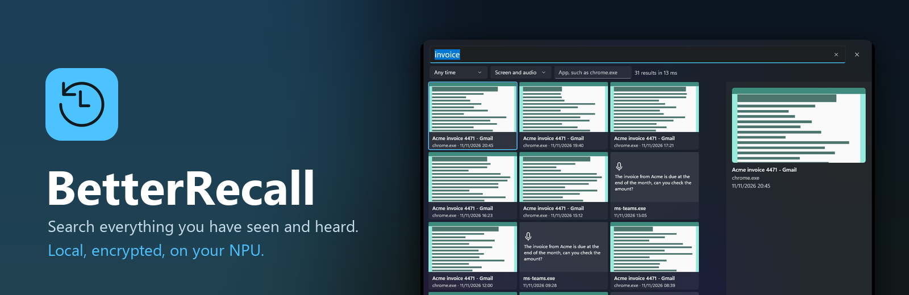
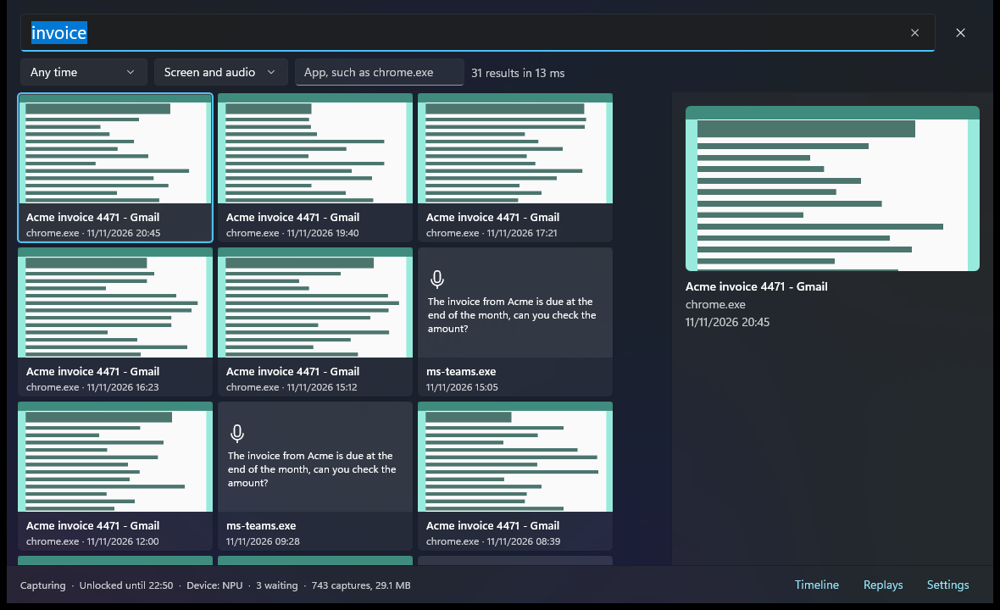
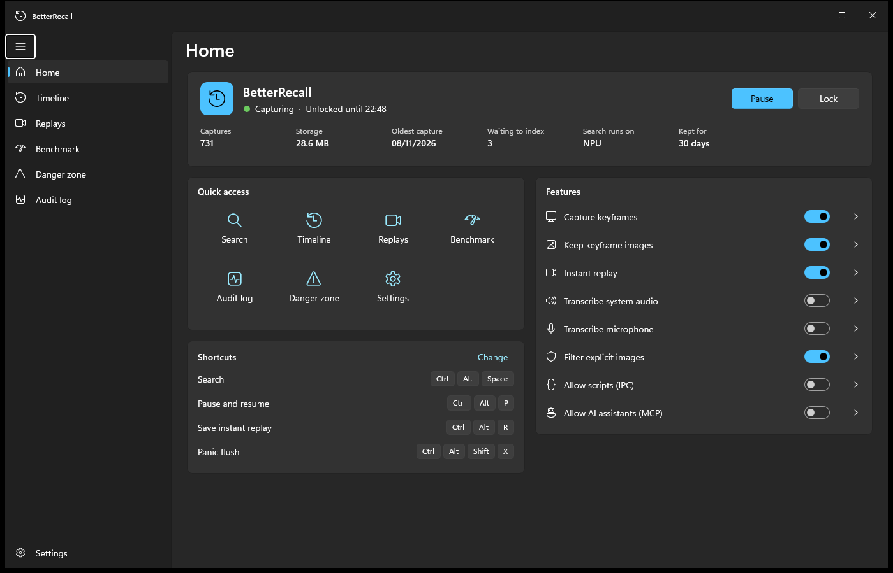
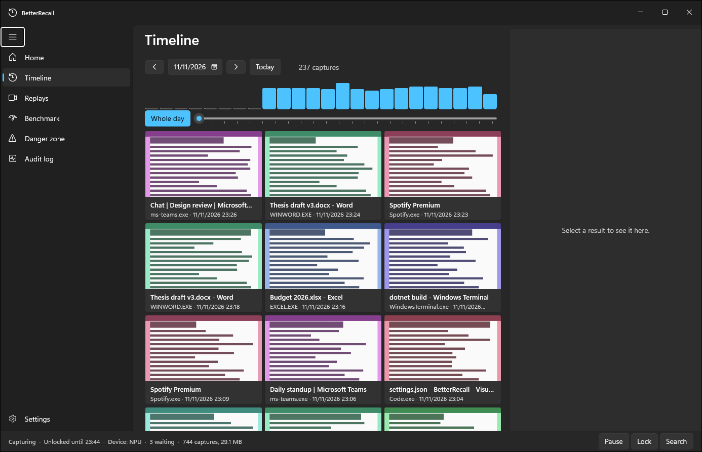
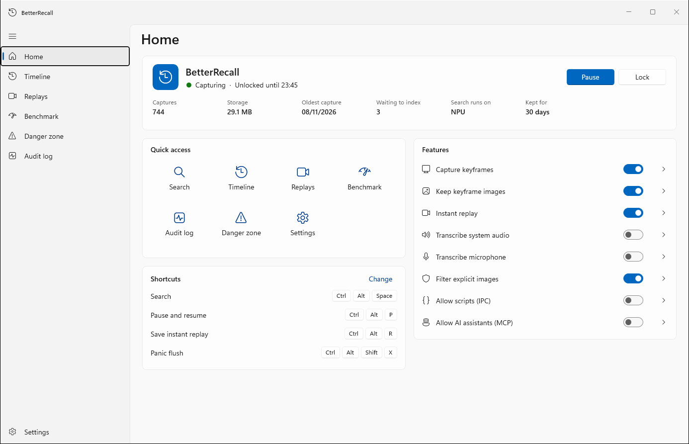

BetterRecall is a local alternative to Windows Recall. It keeps an encrypted history of your screen, and of speech it hears, and lets you search it in your own words: "the invoice from Acme", "that flight to Tokyo", "what was said in standup". Images and text are embedded on your NPU or GPU with EmbeddingGemma 2. The history stays on your PC, encrypted with a key held by the TPM behind Windows Hello. BetterRecall itself makes no network connections.

It also keeps an instant replay buffer, so you can save the last minutes of your screen as a video. It skips private browser windows, apps you exclude and explicit images.

  
  

  
  

Screenshots show the real app running on demo data (`--mock`).

**Status:** early development, Windows 11 x64. There is no installer yet; build from source and download the models from [Hugging Face](https://huggingface.co/lnminh1411/BetterRecall-models). **Docs:** [`docs/`](docs/documentations_summary.md). **Licences:** the WinUI app and contracts are MIT, the rest is AGPL-3.0 ([`LICENSING.md`](LICENSING.md)); models keep their own licences.
